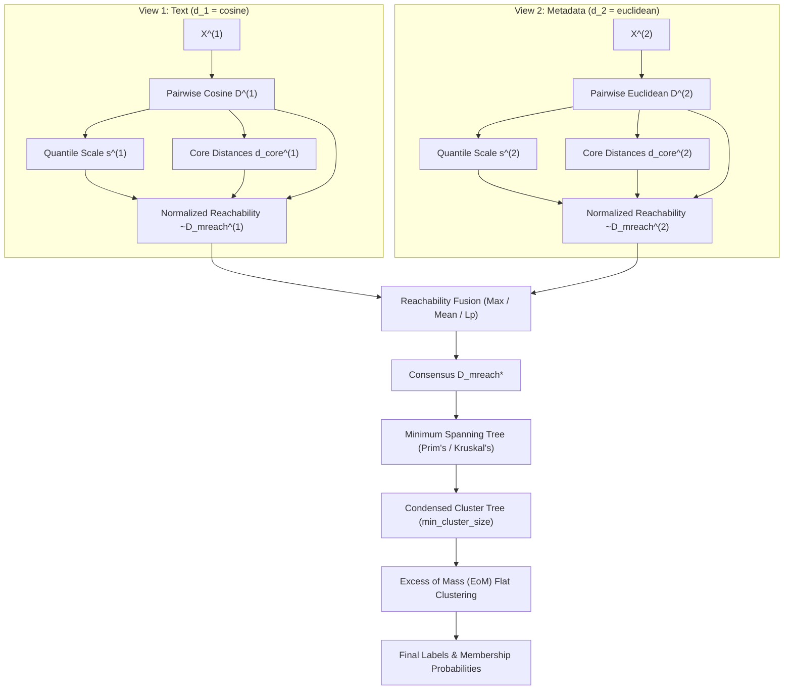

# Multi-View Metric Heterogeneity in MV-HDBSCAN

## 1. Motivation: The Need for Per-View Distance Metrics

Real-world multi-view data is inherently **heterogeneous**. The representations (views) describing the same set of underlying entities typically originate from fundamentally different modalities, domains, or feature extractors:

1. **Text & Unstructured Semantic Representations**:
   - Modern neural encoders (SentenceTransformers, LLM embeddings, CLIP text encoders) produce high-dimensional dense vectors ($d \in [384, 1536]$) lying on or near a unit hypersphere $S^{d-1}$.
   - For normalized embeddings, the **angular / cosine distance** ($d_{\text{cosine}}(u, v) = 1 - \frac{u \cdot v}{\|u\|_2 \|v\|_2}$) accurately isolates semantic alignment independent of vector length.

2. **Tabular & Structured Metadata**:
   - Continuous numerical attributes (e.g., age, financial metrics, spatial coordinates, time-to-event, sensor readings) reside in Euclidean spaces $\mathbb{R}^k$.
   - Proximity is naturally expressed by **Euclidean distance** ($L_2$) or **Manhattan distance** ($L_1$), where differences along individual physical dimensions carry additive metric meaning.

3. **Categorical & Sparse Binary Features**:
   - One-hot encoded tags, permissions, or transactional item sets often require set-theoretic distances such as **Jaccard** or **Hamming distance**.

### Why Feature Stacking (Early Concatenation) Fails

In naive feature stacking, all views are concatenated into a single vector $[x^{(1)} \Vert x^{(2)} \Vert \dots \Vert x^{(V)}]$ and clustered using a single global metric (typically Euclidean). This introduces severe failure modes:

- **Geometric Distortion**: Imposing Euclidean geometry on text embeddings degrades cosine angular separation. Points with high directional similarity but slightly different lengths or norms become artificially distant.
- **Curse of Dimensionality & Scale Domination**: A 768-dimensional text embedding vector will overwhelmingly dominate a 5-dimensional metadata vector in Euclidean space, effectively silencing the metadata view.
- **Semantic Incoherence**: Concatenating different units (e.g., $1536$ semantic dimensions with age and salary) produces an uninterpretable space where distances lose physical and statistical validity.

**Multi-View HDBSCAN solves this** by allowing each view $v \in \{1, \dots, V\}$ to be equipped with its own native metric $d^{(v)}(\cdot, \cdot)$, preserving the intrinsic geometry of each modality before density fusion.

---

## 2. Mathematical Justification

Let $\mathcal{O} = \{o_1, o_2, \dots, o_n\}$ be a set of $n$ physical entities observed across $V$ views. Each view is modeled as an independent metric space:
$$(\mathcal{X}^{(v)}, d^{(v)}), \quad v \in \{1, \dots, V\}$$
where $d^{(v)}: \mathcal{X}^{(v)} \times \mathcal{X}^{(v)} \to \mathbb{R}_{\ge 0}$ satisfies the metric properties (non-negativity, identity of indiscernibles, symmetry, and triangle inequality).

### 2.1 View-Specific Density & Core Distance

HDBSCAN relies on continuous kernel/nearest-neighbor density estimates. For a given smoothing parameter $m_{\text{pts}}$ (or `min_samples`), the **core distance** of an object $x_i$ in view $v$ is the radius of the smallest closed ball in metric $d^{(v)}$ containing at least $m_{\text{pts}}$ points:
$$d_{\text{core}}^{(v)}(x_i) = d^{(v)}\left(x_i, N_{m_{\text{pts}}}^{(v)}(x_i)\right)$$
where $N_{m_{\text{pts}}}^{(v)}(x_i)$ denotes the $m_{\text{pts}}$-th nearest neighbor of $x_i$ under $d^{(v)}$.

Because the core distance is defined entirely in terms of local ball radii under $d^{(v)}$, it is valid for **any metric space**, including non-Euclidean spaces like Riemannian manifolds, angular hyperspheres, or arbitrary metric graphs.

### 2.2 The Incommensurability Problem & Scale Calibration

While each metric $d^{(v)}$ is valid within its own domain, raw distances across different metrics are **not numerically comparable**:
- **Cosine distance** is strictly bounded: $d_{\text{cosine}} \in [0, 2]$. For dense embeddings, typical distances fall between $0.1$ and $0.8$.
- **Euclidean distance** is unbounded: $d_{\text{euclidean}} \in [0, \infty)$, with typical magnitudes scaling as $O(\sqrt{k} \cdot \sigma)$, where $k$ is the dimensionality and $\sigma$ is feature variance. Unscaled metadata distances can easily reach tens, hundreds, or thousands.

If raw distances were directly combined (e.g., via element-wise maximum or weighted sum):
$$\max\left(d_{\text{cosine}}(x_i, x_j), \, d_{\text{euclidean}}(x_i, x_j)\right) = d_{\text{euclidean}}(x_i, x_j) \quad \text{(almost surely)}$$
The larger metric would unilaterally dictate clustering, neutralizing the other views.

Furthermore, HDBSCAN interprets edge weights as density levels:
$$\lambda = \frac{1}{d_{\text{mreach}}}$$
If the distance scales are misaligned, a density threshold $\lambda$ corresponding to dense cores in View 1 would correspond to complete noise in View 2.

#### Robust Quantile Calibration

To resolve incommensurability without sensitivity to outliers, each view's pairwise distance matrix $D^{(v)}$ and core distances are calibrated using a scale factor derived from a robust quantile $q$ (default $q = 0.95$, or median $q = 0.50$):
$$s^{(v)} = Q_q\left( \{ d^{(v)}(x_i, x_j) \}_{1 \le i < j \le n} \right)$$
The calibrated distances are given by:
$$\tilde{D}^{(v)} = \frac{D^{(v)}}{s^{(v)}}, \qquad \tilde{d}_{\text{core}}^{(v)}(x_i) = \frac{d_{\text{core}}^{(v)}(x_i)}{s^{(v)}}$$

**Properties of Quantile Calibration**:
1. **Scale Invariance**: Multiplying any view's coordinate space by an arbitrary constant $c > 0$ leaves the normalized distances $\tilde{D}^{(v)}$ unchanged.
2. **Comparable Dynamic Range**: For all views, the 95th percentile distance becomes exactly $1.0$, aligning the effective density spectrum $\lambda \in [1, \infty)$ across all views.
3. **Outlier Robustness**: Unlike min-max scaling ($D / \max(D)$), quantile calibration is immune to extreme isolated noise points that could arbitrarily compress dense cluster distances.

---

### 2.3 Mutual Reachability Formulation Under Heterogeneous Metrics

The calibrated view-specific mutual reachability distance between objects $x_i$ and $x_j$ in view $v$ is:
$$\tilde{d}_{\text{mreach}}^{(v)}(x_i, x_j) = \max\left\{ \tilde{d}_{\text{core}}^{(v)}(x_i), \, \tilde{d}_{\text{core}}^{(v)}(x_j), \, \tilde{d}^{(v)}(x_i, x_j) \right\}$$

Mutual reachability spreads low-density points apart while maintaining dense point affinities.

#### Fusion Strategies

The calibrated view reachability matrices are aggregated into a consensus multi-view mutual reachability matrix $D_{\text{mreach}}^*$:

1. **Strict Consensus (Intersection / $\text{Max}$)**:
   $$d_{\text{mreach}}^*(x_i, x_j) = \max_{v \in \{1, \dots, V\}} \tilde{d}_{\text{mreach}}^{(v)}(x_i, x_j)$$
   - **Semantics**: Points are mutually reachable at threshold $\epsilon$ if and only if they are mutually reachable at $\epsilon$ across **every** view simultaneously.
   - **Clustering effect**: Clusters represent consensus groupings supported by all modalities; noise in any single view segregates doubtful points.

2. **Weighted Generalized $L_p$ Mean**:
   $$d_{\text{mreach}}^*(x_i, x_j) = \left( \sum_{v=1}^V w_v \left(\tilde{d}_{\text{mreach}}^{(v)}(x_i, x_j)\right)^p \right)^{1/p}$$
   - When $p = 1$, this corresponds to a weighted arithmetic average.
   - When $p \to \infty$, it converges to the strict maximum.
   - Allows trade-offs between modalities based on user-specified view confidence weights $\{w_v\}$.

3. **Optimistic Union ($\text{Min}$)**:
   $$d_{\text{mreach}}^*(x_i, x_j) = \min_{v \in \{1, \dots, V\}} \tilde{d}_{\text{mreach}}^{(v)}(x_i, x_j)$$
   - Connects points if they form a dense cluster in *at least one* view.

---

## 3. Algorithmic Implications

### 3.1 Pipeline Overview



### 3.2 Computational Complexity

- **Pairwise Distance Computation**:
  - View $v$ with metric $d^{(v)}$ requires $O(n^2 \cdot \dim(X^{(v)}))$ operations.
  - Cosine distance for $L_2$-normalized embeddings reduces to a matrix multiplication $D = 1 - X X^T$, highly accelerated by BLAS/GPU ($O(n^2 d)$ with small constant factors).
  - Euclidean distance can likewise leverage squared expansion $\|x_i - x_j\|^2 = \|x_i\|^2 + \|x_j\|^2 - 2 x_i^T x_j$.
- **Sorting for Core Distances**:
  - Finding the $k$-th neighbor requires finding the $k$-th order statistic: $O(n^2)$ using `np.partition` or $O(n^2 \log n)$ via sort.
- **Fusion & MST**:
  - Graph fusion: $O(V \cdot n^2)$ element-wise operations.
  - MST construction on dense graph: $O(n^2)$ using Prim's algorithm.
  - Condensed tree and EoM cluster selection: $O(n \log n)$.

**Total Time Complexity**: $O\left(\sum_{v=1}^V \dim(X^{(v)}) \cdot n^2 + n^2\right)$, identical in order to single-view HDBSCAN with precomputed distances.

### 3.3 Memory Footprint

- Pairwise distance and reachability matrices each require $\frac{n(n-1)}{2} \times 8$ bytes (or $n \times n \times 8$ bytes in square form).
- For $n = 10{,}000$, an $n \times n$ float64 matrix requires $\approx 800\text{ MB}$.
- By fusing view reachabilities iteratively or streaming view computation, peak memory can be bounded to $O(n^2)$ rather than $O(V \cdot n^2)$.

---

## 4. API Specification & Usability

The `MultiViewHDBSCAN` class accepts `metric` as either:
1. A single string (e.g. `metric="euclidean"`): applied uniformly across all views.
2. A sequence of strings / callables matching the number of views (e.g. `metric=["cosine", "euclidean"]`): assigns each view its specialized metric.

### Example Usage

```python
from src.mv_hdbscan import MultiViewHDBSCAN

# View 1: 384-dimensional text embeddings
# View 2: 6-dimensional tabular metadata
views = [text_embeddings, tabular_metadata]

clusterer = MultiViewHDBSCAN(
    metric=["cosine", "euclidean"],
    fusion="max",           # Strict consensus across both views
    scale_views=True,       # Ensures cosine and euclidean reachabilities are commensurate
    scale_percentile=95.0,  # 95th percentile distance calibration
    min_cluster_size=15,
    min_samples=5
)

labels = clusterer.fit_predict(views)
```
